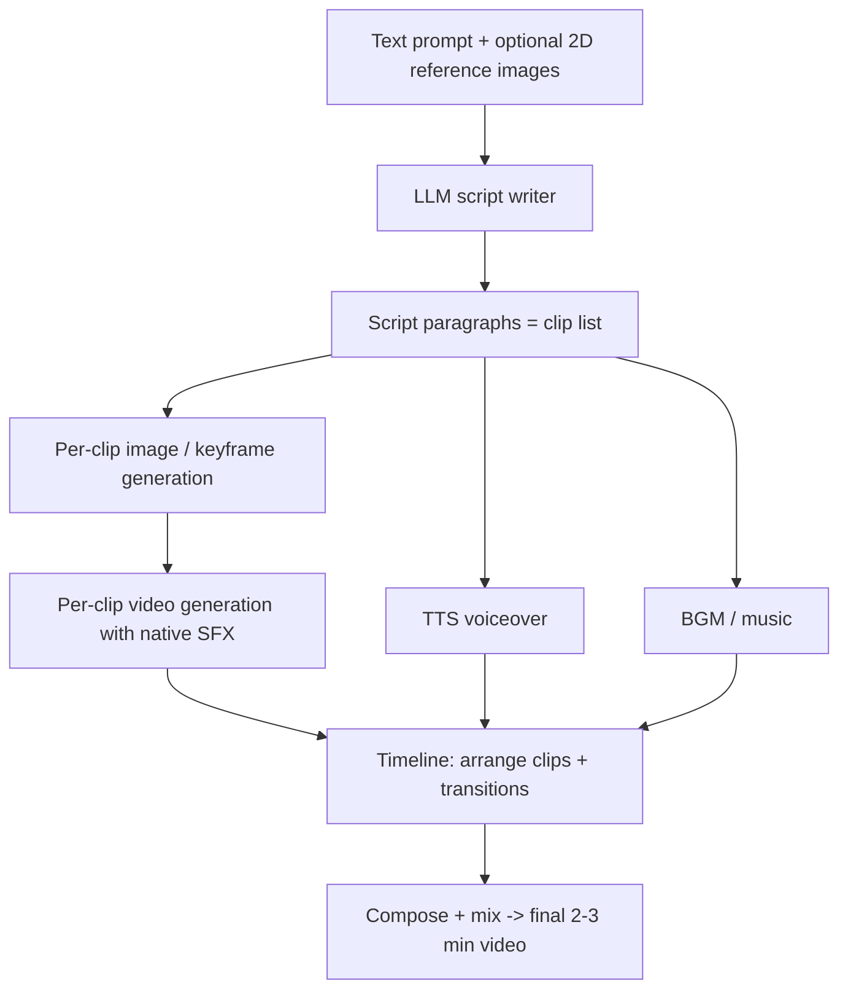

# chat2movie — Prompt-to-Video Pipeline (Work Log)

> **Note:** This file is the working spec + log for the automatic
> **text-prompt → finished video** pipeline and the AI models that power it.
> The original project documentation lives in
> [`README_toonflow.md`](./README_toonflow.md).

---

## 1. Objective

Turn a short user prompt into a **3–5 minute composite video** assembled from
multiple generated clips, with **voiceover (TTS)** and **background music (BGM)**
mixed over the clips' native sound.

**User input**
- A **text prompt** (the story / scene description).
- **Optional 2D reference images** (character, style, or scene references).

**Output**
- A **3–5 min composite video** made of **multiple clips**, plus **voiceover** and
  **BGM**. Each clip also carries **native SFX/ambient audio** generated together
  with its frames.

### Two operating modes

**(1) One-shot, fully automatic**
- The system generates the **full finished video end-to-end** with no user
  interaction.
- The user may then **manually edit any intermediate step** (script, a clip's
  prompt, a keyframe, a clip, the voiceover, the BGM) and **re-run only the
  downstream steps** that depend on it.

**(2) Step-by-step**
- The **LLM splits the prompt into script paragraphs**; **each paragraph = one
  clip**.
- The user **reviews** the paragraphs, **rearranges clips**, **adds transitions**,
  then **renders the final video**.



---

## 2. AI models

### 2.1 What AI models do we need?

| # | Capability | Role in the pipeline | Modality |
| --- | --- | --- | --- |
| 1 | **LLM / script writer** | Split the prompt into script paragraphs, per-clip prompts, and transition hints | text → text |
| 2 | **Image generation / editing** | Keyframes, reference frames, character/style consistency from the optional 2D references | text (+ image) → image |
| 3 | **Video generation** | Turn each script paragraph (and/or keyframe) into a clip **with native SFX** | text (+ image) → video+audio |
| 4 | **TTS voiceover** | Narration / dialogue; supports **voice cloning** for a custom narrator | text → audio |
| 5 | **Music / BGM** | Background score for the final mix | text (+ lyrics) → audio |
| 6 | *ASR (optional)* | Auto-subtitles / captions for the voiceover | audio → text |

### 2.2 Candidate models — Bailian vs other platforms

Almost everything is available on **Alibaba Bailian (Model Studio / DashScope)**.
**Only music/BGM must come from other platforms.**

| Capability | Candidate model | Platform | Priority | Notes |
| --- | --- | --- | --- | --- |
| Video | `happyhorse-1.1-t2v` | **Bailian** | 1 (primary) | Text→video; **native SFX confirmed** (e.g. sword clash, wind) |
| Video | `wan3.0-video` | **Bailian** | 2 (fallback) | Text→video; **native audio live-verified** (mp4 = h264 + aac) |
| Image | `wan2.7-image` | **Bailian** | 1 (primary) | Modes `text` **and** `singleImage` → supports **image editing** from a 2D reference |
| Image | `qwen-image-3.0-pro` | **Bailian** | 2 (fallback) | `text` only (no reference-image editing) |
| TTS | `qwen-audio-3.0-tts-plus` | **Bailian** | 1 | Voices `longanlingxin` (female), `longanlufeng`; **voice cloning** via `voice-enrollment` |
| ASR (opt.) | `qwen-audio-3.0-asr-flash` | **Bailian** | — | Available on Bailian; not yet wired |
| LLM / script | `qwen3.8-max-preview`, `qwen3.7-max`, `qwen3.7-plus`, `qwen3.6-flash`, `glm-5.2`, `deepseek-v4-pro` | **Bailian** (compatible-mode) / TF-router | — | Chat models used as the script writer |
| **Music / BGM** | `music-01` (MiniMax Music-01) | **MiniMax** (other platform) | 1 | Sync; seeded example |
| **Music / BGM** | `fal-ai/musicgen` (MusicGen) | **fal.ai** (other platform) | 2 | Async queue; seeded example |
| **Music / BGM** | Suno (and similar) | other platform | — | Candidate; not yet wired |

> **Design principle:** *no hard-coded models.* Each provider
> (`bailian`, `music`) is a generic, config-driven engine — model IDs, endpoints,
> call mode, result paths, and candidate ordering all live in an editable
> `adapter` per model. Each capability can hold **multiple candidates**; the
> primary is tried first and the engine **auto-falls-back** on failure.

### 2.3 How to call each model — and access status

Host: **Token Plan keys (`sk-sp-…`)** use
`https://token-plan.cn-beijing.maas.aliyuncs.com`; **standard keys (`sk-…`)** use
`https://dashscope.aliyuncs.com`. Access status below is against the **current
`sk-sp-` Token Plan key**.

| Model / capability | Call (endpoint · mode · body → result) | Access now |
| --- | --- | --- |
| **Video** (`happyhorse-1.1-t2v`, `wan3.0-video`) | `POST /api/v1/services/aigc/video-generation/video-synthesis` · **async** (header `X-DashScope-Async: enable`) · body `{ model, input:{ prompt }, parameters:{ resolution, duration, audio:true } }` → poll `GET /api/v1/tasks/{id}` until `output.task_status == SUCCEEDED` → `output.video_url` | ✅ **WORKS** (live-verified) |
| **Image** (`wan2.7-image`, `qwen-image-3.0-pro`) | `POST /api/v1/services/aigc/text2image/image-synthesis` · **async** · body `{ model, input:{ prompt[, refImage] }, parameters:{ size, n } }` → poll `/api/v1/tasks/{id}` → `output.results.0.url` | ❌ **BLOCKED** on `sk-sp-` (async → `403 …does not support asynchronous calls`; sync → `400 url error`). Wired but **dormant** |
| **TTS** (`qwen-audio-3.0-tts-plus`) | `POST /api/v1/services/audio/tts/SpeechSynthesizer` · **sync** · body `{ model, input:{ text, voice, format, sample_rate } }` → `output.audio.url` (or `output.audio.data`). Note: `voice/format/sample_rate` live in **`input`**, not `parameters` (`adapter.audioParamsInInput = true`) | ❌ **BLOCKED** on `sk-sp-` (same tier). Wired but **dormant** |
| **Voice cloning** (`voice-enrollment`) | `POST /api/v1/services/audio/tts/customization` · body `{ model:"voice-enrollment", input:{ action:"create_voice", target_model, prefix, audio } }` → `output.voice_id`; poll `action:"query_voice"` until `output.status === "OK"`; then use that `voice_id` as the TTS `voice`. Cloned voice is **bound to `target_model`**. Sample audio: WAV/MP3/M4A, 10–20 s (≤60 s), ≤10 MB, ≥16 kHz | ❌ **BLOCKED** on `sk-sp-` (same tier). Config-only, **dormant** |
| **LLM / script** (chat models) | `POST {base}/compatible-mode/v1/chat/completions` · OpenAI-compatible · body `{ model, messages }` → `choices[0].message.content` | ✅ **WORKS** on `sk-sp-` |
| **Music** (`music-01`, MiniMax) | `POST https://api.minimaxi.com/v1/music_generation` · **sync** · `authStyle: bearer` · body `{ model, prompt, lyrics, audio_setting }` → `data.audio_url` / `data.audio` | ❌ **No vendor key** configured. Dormant example |
| **Music** (`fal-ai/musicgen`, fal.ai) | `POST https://queue.fal.run/fal-ai/musicgen` · **async** · `authStyle: key` · body `{ prompt, duration }` → `request_id`; poll `…/requests/{{taskId}}` → `status == completed` → `audio.url` | ❌ **No vendor key** configured. Dormant example |

**Bottom line:** with the current key only **video** and **chat/LLM** are live.
**Image, TTS, and voice cloning are fully wired but blocked** by the `sk-sp-`
Token Plan tier — they activate with **zero code change** once a capable key/host
is supplied. **Music is wired but needs a real vendor key** (MiniMax / fal.ai /
Suno).

---

## 3. Where configuration lives

### 3.1 API keys — repo-root `config.json` (central key store)

Provider keys can be stored centrally in a **repo-root `config.json`** that is
**git-ignored** (`chmod 600`). Template: [`config_sample.json`](./config_sample.json).

```jsonc
{
  "providers": {
    "bailian": { "apiKey": "sk-sp-…", "baseUrl": "https://token-plan.cn-beijing.maas.aliyuncs.com" },
    "music":   { "apiKey": "…",       "baseUrl": "…" }
  }
}
```

- Keyed by **provider id** (`bailian`, `music`, `tfRouter`, …); value =
  `{ apiKey, baseUrl }`.
- **Precedence:** `config.json` **wins** over `data/settings.json`; any provider
  not listed falls back to the value saved in the Settings UI.
- Loader: `apps/server/src/utils/appConfig.ts` (`getConfigApiKey` /
  `getConfigBaseUrl`; mtime-cached; strips a stray `Bearer ` prefix; silently
  returns empty if the file is missing so the app still boots). Path override via
  `TOONFLOW_CONFIG_FILE`.
- Wired at the two media choke points: `getMediaProviderApiKey` (provider.ts) and
  `configuredProvider` (generation.ts). *Chat/custom providers still read
  `settings.customProviders[].apiKey` only.*

### 3.2 Provider config — 3 tiers (models vs secrets; **do not merge**)

**Conclusion: do not merge.** Models and secrets live in different tiers and never
overlap, so there is no conflict.

| Tier | File | Holds | Edited by |
| --- | --- | --- | --- |
| **A · Package seed** | `packages/providers/src/media/bailian.ts` | Template **code + default `models[]` + `rules[]` form schema**, plus the `mediaProviders` registry entry and the dialog `?raw` import | Us (version-controlled) |
| **B · Installed source** | `data/providers/bailian.ts` | The **actual runtime** code + `models[]` — a copy of A created when the provider is added | UI via `saveMediaProvider` (string-patches the `models:` region) / `refreshMediaProviderModels` |
| **C · Config store** | `data/settings.json` → `settings.mediaProviderConfigs.bailian` | **Only** config values (`apiKey`, `baseUrl`); **never** models. Mode `0o600`, git-ignored, watched | UI (Layer 3) |

- **At call time:** `loadMediaProviderSource` builds config as
  `{ ...rulesDefaults, ...settings.json values }` (with `config.json` overriding
  per §3.1) and reads `models` from the source file.
- **UI (Layer 3) = single editor:** *Settings → Media Models* edits both models
  (written back to tier B) and `apiKey`/`baseUrl` (written to tier C).
- **Drift caveat:** tier B is a *fork* of tier A — editing the package seed does
  **not** auto-update an installed provider. Our seed has **no `modelsUrl`**, so a
  refresh can't re-pull models without losing the `adapter` config; seed changes
  require **re-install** for existing installs. *(Bailian is not installed yet —
  `data/providers/` currently has no `bailian.ts`.)*

---

## 4. Toonflow commercial platform (TF-Router) — integration investigation

> **Scope:** read-only investigation. Per product decision the links and the
> integration are **kept as-is** (the ~90 `api.toonflow.net` references remain).
> This section documents *how the fork talks to the vendor's hosted platform* —
> connect/login, pay/recharge, account & balance, and fetching assets — so the
> coupling is fully understood before any future removal.

### 4.1 What TF-Router is

**TF-Router** (`https://api.toonflow.net`) is the upstream vendor's **hosted
commercial platform**: an account/billing service, a paid AI-model gateway
(image / video / audio generation), a community gallery (“explore”), and a
plugin market. The rebranded app is **functionally tied** to it for those
features. A **live probe confirms it is reachable** (landing/login pages return
`200`; the JSON API responds and `401`-gates the auth-only routes — see §4.9).
The *authenticated* flows (pay / balance / generation) still need a valid key to
verify end-to-end. The app also runs on **private/local providers** (`bailian`,
`music`, custom), which never touch `api.toonflow.net`.

### 4.2 The single client & auth contract

All *direct* browser→vendor calls live in one module:
[`apps/web/src/lib/tf.ts`](./apps/web/src/lib/tf.ts).

- `const client = axios.create({ baseURL: "https://api.toonflow.net" })`.
- **Auth:** `Authorization: Bearer <apiKey>` (a stray `Bearer ` prefix is
  stripped). Only the **explore read** endpoints (list / detail / process /
  download) and **sponsors** run **anonymously**; a key adds per-user state
  (like/collect). The **plugin market, recharge/billing, balance, and model
  generation** endpoints are **auth-gated** (`401` without a Bearer key) — see
  the verified access matrix in §4.9.
- **Response contract:** every endpoint returns `{ code, data, message? }`;
  `code === 200` is success. `tf.ts` strictly validates each payload shape and
  throws Chinese error strings otherwise.
- **Key resolution** (`getTfApiKey`): first non-empty of
  `settings.customProviders[tfRouter].apiKey` → `settings.mediaProviderConfigs.tfRouter.apiKey`.
- **Provider guard** (`isTfRouterProvider`): `id.toLowerCase() === "tfrouter"`
  **and** `apiUrl` origin `=== https://api.toonflow.net`.

Balance and *model generation* do **not** go browser→vendor directly; they are
proxied by the **local chat2movie server** (see §4.5–4.6).

### 4.3 Connect / login (how the platform is wired in)

Two entry points install the API key:

1. **Onboarding auto-config** — [`apps/web/src/pages/hello/index.vue`](./apps/web/src/pages/hello/index.vue):
   - “登录 TF-Router 自动配置” opens an **iframe** to
     `https://api.toonflow.net/login?type=toonflow` (themed via `bgcolor`/`txtcolor`).
   - The vendor page **postMessage**s back `{ type: "login"|"register", msg, key, error }`;
     the app checks `event.origin === loginOrigin` and `event.source === iframe`.
   - On `login`+`success` with a valid `key`, `configureProviders()`:
     1. `GET /api/providers/media/list`; if `tfRouter` is absent,
        `POST /api/providers/media/add { source }` where `source` is the
        `@toonflow/providers/media/tfRouter?raw` file text.
     2. `saveSettings(...)` writes the key into **both**
        `customProviders[tfRouter].apiKey` (language) and
        `mediaProviderConfigs.tfRouter.apiKey` (media).
     3. `invalidateNodeModels("media")` → `hello.complete()` → route `/home`.
   - A **retry** button re-runs config if it failed but a key was received.
2. **Manual key entry** — [`tfAccount.vue`](./apps/web/src/components/settings/tfAccount.vue)
   (rendered inside *Settings → Language/Media Models* and the canvas provider
   menu): paste an API Key → `saveApiKey()`. Includes an external link
   “前往 TF-Router 官网 获取 API Key” → `https://api.toonflow.net/`.

There is **no in-app registration, profile, or password management** — those
live only on the vendor website. “Modify account” in-app == **set/replace the
API key** and **recharge the balance**.

### 4.4 Pay / recharge (how money flows)

Driver: [`tfRechargeDialog.vue`](./apps/web/src/components/settings/tfRechargeDialog.vue)
(lazy-loaded from `tfAccount.vue` → “充值”), using `tf.ts`:

| Step | Call | Endpoint | Notes |
| --- | --- | --- | --- |
| Load packages | `tf.getRechargeData()` | `GET /v1/recharge/getRechargeData` | Returns SKUs `{ id, price, integral, describe }` |
| Create order | `tf.pay({ comboId, customMoney?, payType })` | `POST /v1/recharge/pay` | `payType` = `wechat` \| `alipay`; `comboId = -1` → custom amount (¥0.01–50000) |
| Poll status | `tf.queryOrder(orderNumber)` | `GET /v1/recharge/queryOrder` | Returns `{ orderNumber, status }` |

- `pay` returns `{ orderNumber, payUrl }`.
  - **WeChat:** `payUrl` is rendered as a **QR image** (`el-image`) → scan to pay.
  - **Alipay:** `window.open(payUrl)` (also shown as an external-link button).
- Currency is **CNY**; payment rails are **China-domestic** (WeChat Pay / Alipay).
- After paying, closing the dialog triggers a **balance refresh** (§4.5).

### 4.5 Account & balance (read + live updates)

Balance is fetched **through the local server**, not directly from the vendor:

- [`providerBilling.ts`](./apps/web/src/lib/providerBilling.ts) →
  `getProviderBalance("tfRouter", { apiKey })` posts
  `POST /api/ai/media/balance { providerId, apiKey }`
  (header `x-toonflow-workspace: 1`). For `tfRouter` the key is
  `tfBalanceApiKey` (media config key, falling back to `getTfApiKey`).
- The server ([`media/billing.ts`](./apps/server/src/utils/media/billing.ts),
  [`media/provider.ts`](./apps/server/src/utils/media/provider.ts)) **special-cases
  `tfRouter`** (api-key normalization; a `404` fallback stub) and calls the
  provider's `getBalance`/`getPrice` against the vendor.
- **Live updates:** SSE `GET /api/ai/media/balanceEvents?accountIds=…`
  (accounts grouped 100-per-connection); `applySnapshot` patches balances by
  `accountId` + `revision`.
- `providerBalances` **always pins `tfRouter` first** (`syncProviders` seeds a
  hard-coded `{ id: "tfRouter", label: "TF-Router", supportsBalance: true }`).
- `tfAccount.vue` displays **account balance, key balance (`null` = unlimited),
  total consumption, total recharge**, with refresh + recharge buttons.

### 4.6 Get assets (generation, community, plugins, sponsors)

**Four asset channels**, all backed by `api.toonflow.net`:

1. **Paid model generation** (the core “get asset” path) —
   [`packages/providers/src/media/tfRouter.ts`](./packages/providers/src/media/tfRouter.ts)
   (`apiUrl = https://api.toonflow.net/v1`) exposes `generateImage`,
   `generateVideo`, `generateAudio`, `getPrice`, `getBalance` and a model list
   (Seedance / wan / MiniMax-H3 / doubao-seedream / 全能图片 / seed-audio).
   The **server** drives it: [`media/generation.ts`](./apps/server/src/utils/media/generation.ts)
   includes `"tfRouter"` in the allowed-provider list; `provider.ts` supplies
   `modelsUrl`, price and balance fallbacks.
2. **Community gallery (“explore”)** — [`home/explore.vue`](./apps/web/src/pages/home/explore.vue)
   + `exploreDetail.vue` + `exploreProcess.vue`, via `tf.ts`:

   | Call | Endpoint | Purpose |
   | --- | --- | --- |
   | `getExploreProjects` | `POST /v1/explore/getProjects` | Paged list (cursor), categories, search; anon allowed |
   | `getExploreProject` | `POST /v1/explore/getProject` | Detail (description, videoUrl, shareUrl) |
   | `setExploreReaction` | `POST /v1/explore/setReaction` | like / collect (sets state, not toggle) |
   | `getExploreProcess` | `POST /v1/explore/getProcess` | Read-only canvas JSON (nodes/edges/groups) |
   | `getExploreDownload` | `POST /v1/explore/getDownload` | Short-lived **signed HTTPS** zip of the whole project (canvas JSON + assets) |

3. **Plugin market** — [`settings/panels/pluginMarket/index.vue`](./apps/web/src/components/settings/panels/pluginMarket/index.vue):
   `tf.getPlugIn` → `POST /v1/plugin/getPlugin` (types `node`/`skill`/`tool`/
   `agent`/`ext`/`my`/`collection`); `tf.toggleCollection` →
   `POST /v1/plugin/toggleCollection`.
4. **Sponsors** — `tf.getSponsorList` → `POST /web/sponsor/getSponsorList`
   (rendered in the About panel).

**Telemetry (side channel):** [`anonymousData.ts`](./apps/web/src/lib/anonymousData.ts)
posts usage to `https://api.toonflow.net/web/telemetry/report`.

### 4.7 Server-side “reference provider” coupling

`tfRouter` is hard-wired as the **default/reference provider** on the server,
so removing it later is *surgical*, not a delete:

- [`conf/index.ts`](./apps/server/src/utils/conf/index.ts): `autoInstallProviders = [tfRouter]`
  → auto-added to `settings.customProviders` on boot.
- [`app.ts`](./apps/server/src/app.ts): `autoInstallProviders` includes `"tfRouter.ts"`
  → `initializePlugins` copies the provider source into `data/providers/`.
- [`ai/initialize.ts`](./apps/server/src/utils/ai/initialize.ts):
  `initializeProviderModels` / `refreshProviderModels` are keyed on `tfRouter`
  (consumed by `app.ts` and `routes/settings/save.ts`).
- [`media/provider.ts`](./apps/server/src/utils/media/provider.ts),
  [`media/billing.ts`](./apps/server/src/utils/media/billing.ts),
  [`media/generation.ts`](./apps/server/src/utils/media/generation.ts):
  `tfRouter.id` branches for price, balance, `modelsUrl`, api-key
  normalization, and the allowed-provider list.
- Sort pinning to keep TF first: [`nodeShared/groupNodeModels.ts`](./packages/nodeShared/src/groupNodeModels.ts)
  and [`modelPopover.vue`](./apps/web/src/components/modelPopover.vue).

### 4.8 Endpoint inventory (base `https://api.toonflow.net`)

| Purpose | Method · path | Caller | Auth |
| --- | --- | --- | --- |
| Login page (iframe) | `GET /login?type=toonflow` | hello | none (key via postMessage) |
| Recharge SKUs | `GET /v1/recharge/getRechargeData` | tf.getRechargeData | Bearer |
| Create payment | `POST /v1/recharge/pay` | tf.pay | Bearer |
| Query order | `GET /v1/recharge/queryOrder` | tf.queryOrder | Bearer |
| Explore list | `POST /v1/explore/getProjects` | tf.getExploreProjects | optional |
| Explore detail | `POST /v1/explore/getProject` | tf.getExploreProject | optional |
| Explore reaction | `POST /v1/explore/setReaction` | tf.setExploreReaction | Bearer |
| Explore process | `POST /v1/explore/getProcess` | tf.getExploreProcess | optional |
| Explore download | `POST /v1/explore/getDownload` | tf.getExploreDownload | optional |
| Plugin list | `POST /v1/plugin/getPlugin` | tf.getPlugIn | Bearer |
| Plugin collection | `POST /v1/plugin/toggleCollection` | tf.toggleCollection | Bearer |
| Sponsors | `POST /web/sponsor/getSponsorList` | tf.getSponsorList | none |
| Telemetry | `POST /web/telemetry/report` | anonymousData | none |
| Model gen / price / balance / models | `…/v1/…` | media/tfRouter.ts (via server) | Bearer |

**Local chat2movie server wrappers:** `GET /api/providers/media/list`,
`POST /api/providers/media/add`, `POST /api/ai/media/balance`,
`GET /api/ai/media/balanceEvents` (SSE), and the media-generation route.

### 4.9 Anonymous vs authenticated access (verified live)

Probed directly against `api.toonflow.net` **without any API key**. `✅` =
returns data anonymously; `❌ 401` = auth-gated (needs a Bearer key).

| Endpoint (purpose) | Anonymous | With key | In-app behaviour |
| --- | --- | --- | --- |
| `POST /v1/plugin/getPlugin` (**plugin market**) | ❌ 401 | ✅ | **Login required.** `tf.getPlugIn` uses `requestOptions()`, which *throws `请先配置 TF-Router API Key` before sending* when no key — doubly gated |
| `POST /v1/plugin/toggleCollection` | ❌ 401 | ✅ | Write action; auth-gated |
| `POST /v1/explore/getProjects` (list) | ✅ public data | ✅ + your like/collect state | `exploreOptions()` sends an anonymous request when no key |
| `POST /v1/explore/getProject` (detail) | ✅ | ✅ | Public browse |
| `POST /v1/explore/getProcess` (canvas JSON) | ✅ | ✅ | Public, read-only |
| `POST /v1/explore/getDownload` (signed zip) | ✅ | ✅ | Public download |
| `POST /v1/explore/setReaction` (like/collect) | ❌ 401 | ✅ | Write action; auth-gated |
| `POST /web/sponsor/getSponsorList` | ✅ | ✅ | Public |
| `GET /v1/recharge/getRechargeData` · `POST /v1/recharge/pay` · `GET /v1/recharge/queryOrder` | ❌ 401 | ✅ | Billing needs an account |
| Model generation · price · balance (`…/v1/…`, via local server) | ❌ 401 | ✅ | Auth-gated |

**Summary**
- **Public (no login):** the entire **explore read** surface (list / detail /
  process / download) and **sponsors**. Anyone can browse and even download
  community projects anonymously.
- **Login required:** the **plugin market** (all endpoints), explore
  **like/collect**, **recharge/pay/order**, **balance**, and **model generation**.
- **The client-side gate mirrors the server:** `exploreOptions()` degrades to an
  anonymous call when no key is set, whereas `requestOptions()` (plugin market,
  recharge, reactions) **refuses to send** without a key. So the plugin market
  is unreachable in-app until a TF-Router API key is configured.

### 4.10 Bottom line (the “brand vs reality” gap)

The app is **rebranded** but the *connect → pay → balance → assets* lifecycle is
still **owned by the vendor's platform**. The platform is **reachable**
(§4.9): public explore browsing works anonymously, while the plugin market,
billing, balance and generation all require a TF-Router account/key.
**Local/private providers** (`bailian`, `music`, custom) keep the product usable
independently of the vendor. Fully severing this coupling is the paused **B2
“full excision”** task (≈35 files, mostly surgical branch removal),
deliberately **not** done here.

---

## 5. Open problems / decisions needed

1. **Image + TTS blocked by the `sk-sp-` Token Plan tier** (video/chat only).
   Code paths are complete and dormant. *Decision: provision a standard `sk-`
   DashScope key, or a Token Plan key whose tier enables image/TTS.*
2. **Music/BGM has no real vendor key.** Seeded candidates (MiniMax `music-01`,
   fal `musicgen`) are dormant examples. *Decision: pick a music vendor + key
   (MiniMax / fal.ai / Suno) and confirm its endpoint/body schema.*
3. **Bailian provider not installed** into `data/providers/` yet — the key is
   ready in `config.json`, but the provider must be added via *Settings → Media
   Models* before it can run.
4. **~~Pre-existing typecheck error~~ — RESOLVED:** the `electrobun.config.ts`
   TS2307 error is gone. The Android/Windows/macOS client apps, Docker, and all
   desktop/mobile tooling (`electrobun.config.ts`, `hutch.config.ts`, `compat/`,
   `apps/desktop`, `apps/mobile`, `apps/updateServer`, `packages/startup`) were
   removed, and the app version now comes from the root `package.json`. The repo
   is website-only: `apps/server` (Bun + Express) serves the built `apps/web`.
5. **`packages/mcp/src/stdio.ts` shows as modified** in `git status` — pre-existing
   repo state, **not** part of this work; must not be touched or committed here.
6. **Downstream pipeline not built yet:** script orchestrator, timeline /
   composition node, compose+mix engine, and the one-shot vs step-by-step UI are
   still to be implemented.

---

> **Commit policy:** no `git commit` / `push` / `deploy` unless explicitly
> requested (gated per action).
